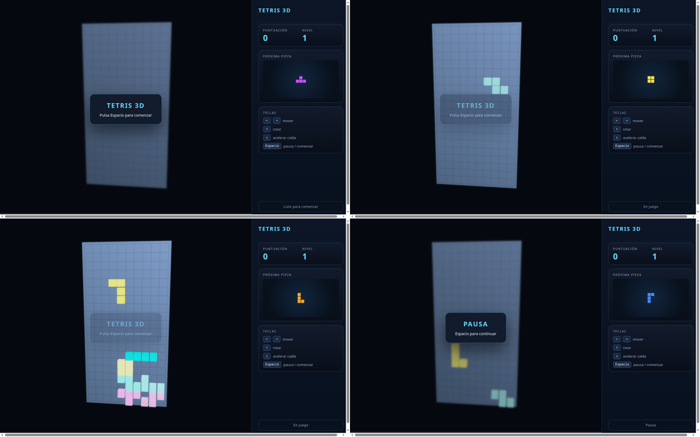
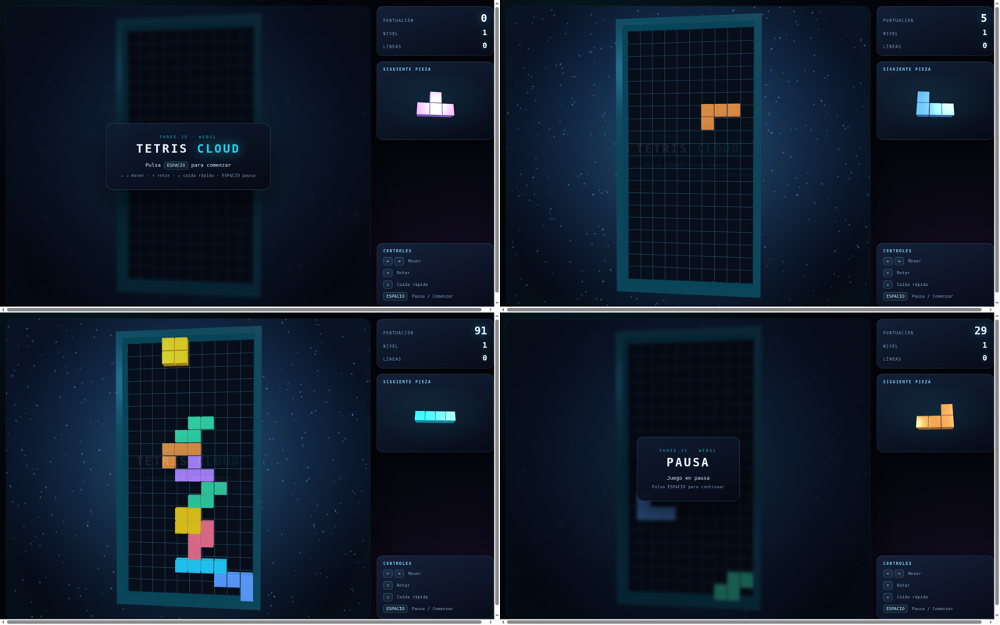
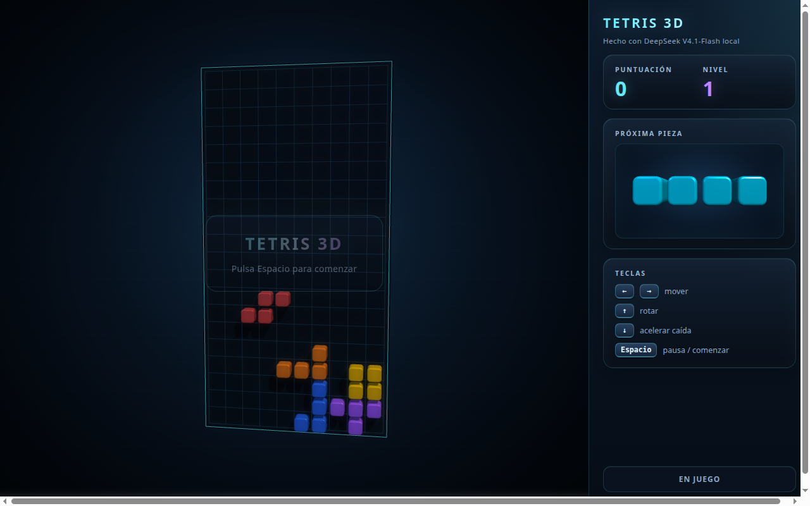

# ds-wormhole: un Tetris, local frente a la nube

<sub>[English](DS_WORMHOLE_TETRIS.md) · <b>Español</b></sub>

¿Cuánto se aleja DeepSeek-V4.1-Flash IQ2_XS en un Strix Halo de 64 GB del modelo que DeepSeek sirve en su nube? Una
prueba sencilla (2026-11-11): el mismo prompt, el mismo cliente de agente y los mismos ajustes, una vez contra esta
máquina y otra contra la API oficial. Las dos son una sola muestra a temperatura 1: es un ejemplo, no un benchmark.

## Montaje

| | Local | Nube |
|---|---|---|
| Modelo | DeepSeek-V4.1-Flash-1017 IQ2_XS (2,25 bpw), `strata-dsv41`, perfil P075a, contexto de 1M | `deepseek-flash` en `api.deepseek.com` |
| Máquina | Ryzen AI MAX+ 395, Radeon 8060S, 64 GB, Linux | servidores de DeepSeek |
| Cliente | el mismo cliente de agente (vibecode) con las mismas herramientas, incluidos un servidor MCP de three.js y un navegador | igual |
| Muestreo | temperatura 1, top_p 0,95, top_k 64, min_p 0,066, razonamiento activado, esfuerzo alto | la misma petición (la API oficial probablemente ignora top_k y min_p) |

El prompt (tal cual se envió; entre las dos pruebas solo cambió el nombre del fichero):

```text
tenemos un MCP de threejs configurado crea un Tetris en ~/tetris_local.html con:
- panel principal (tablero para las fichas)
- paneles laterales derecha: panel con contador de puntuación y nivel, panel de visualización próxima pieza, teclas de ayuda
- controlado por las teclas de cursor a los lados, arriba rotar, abajo aumentar velocidad de caída. "Espacio" para "PAUSA" y "COMENZAR" partida.
- todas las piezas con colores distintos y rotación (cursor arriba)
- animación parpadeante para eliminar las lineas completadas
```

## Las sesiones

| | Local | Nube |
|---|---|---|
| Tiempo total | 55 min | 10 min (unas 5,5× más rápida) |
| Tokens escritos | 63.751 a ~23 t/s | ~91.000 con el razonamiento, ~150 t/s |
| Llamadas a herramientas | 31 | 99 |
| Comprobó su trabajo | sí: empezar, pausar, mover, rotar y fin de partida en el navegador; borrado de cuatro líneas en una copia instrumentada que luego borró | sí, más a fondo: miraba capturas y corrigió sola los colores lavados |
| Erratas | una en el mensaje final («In Incluye») | ninguna |

## Los juegos

Los dos juegos cargan, funcionan y cumplen todos los puntos del prompt. Las capturas se hicieron con un Chromium sin
interfaz (WebGL por software) que pulsa las teclas: pantalla de inicio, jugando, más tarde y en pausa. (El cartel de
inicio se ve medio transparente durante la partida en los dos: viene de la captura sin interfaz, no de los juegos.)

**Local** ([`tetris_local.html`](ds-wormhole-tetris/tetris_local.html)):



**Nube** ([`tetris_cloud.html`](ds-wormhole-tetris/tetris_cloud.html)):



## Puntuación (1-10)

| | Local | Nube | Notas |
|---|---|---|---|
| Cumple el prompt | 9 | 9 | los dos tienen todo lo pedido |
| Jugabilidad | 8 | 9 | los dos usan bolsa de 7 piezas y patadas de pared; la nube además cuenta líneas, puntúa la caída rápida y sube de nivel cada 10 líneas |
| Gráficos | **5** | **9** | local: tablero azul claro lavado, piezas pastel y una perspectiva rara. Nube: marco, rejilla, halo, partículas, cubos con aristas y colores reales |
| Panel lateral | 7 | 9 | el local no tiene contador de líneas y su vista previa es pequeña y plana; la de la nube es grande y gira |
| Código | 7 | 8,5 | la nube reutiliza las mallas y gestiona el espacio de color; el local es correcto pero más simple |
| Autocomprobación | 7 | 9 | |
| Texto y erratas | 8 | 10 | |
| Velocidad | 2 | 10 | |
| Coste y privacidad | 10 | 6 | el local es gratis y nada sale de la máquina |
| **Calidad global del resultado** | **7** | **9** | |

## Segunda vuelta: el modelo local mejora su propio Tetris (v2)

Después de la comparación, el mismo modelo local recibió una sola petición, esta vez desde la web que sirve `strata-dsv41`
(la UI de llama.cpp), no desde vibecode: *«revisa el fichero ~/tetris_local.html la calidad visual no es muy buena a ver
si podemos hacerlo más atractivo y con mejor definición»*. Mismo perfil P075a; temperatura 1, top_k 64, min_p 0,066.

| | Local v2 (mejora) |
|---|---|
| Duración | ~45 min de pared (con un corte: el PC se apagó a mitad y la sesión siguió con «continua por favor») |
| Tokens escritos | 55.320 en 44 peticiones, **21,8 t/s**; contexto hasta 75K |
| Llamadas a herramientas | 49, 0 fallidas (una lectura demasiado grande que repitió por tramos) |
| Cómo lo hizo | leyó el juego entero, listó siete problemas (colores lavados por la luz y sin *tone mapping*, cubos planos, cámara fija, vista previa diminuta, movimiento a saltos y un error de CSS del v1: `n-child` por `nth-child`), hizo un plan y lo aplicó en 25 ediciones |
| Comprobó su trabajo | **sí, con sus propios ojos**: sacó capturas con Chromium sin interfaz, las miró con visión y recalibró luces, exposición y saturación tres veces hasta que dejaron de verse lavadas; probó también la vista móvil y borró sus ficheros de prueba |
| Erratas | dos en prosa, sueltas: «Re reviso» y «Node/PPython»; una en el código, `toneMappingExposure = 09`, que corrigió él mismo en la edición siguiente. El código final no tiene erratas y su JavaScript pasa `node --check` |

**Local v2** ([`tetris_local_v2.html`](ds-wormhole-tetris/tetris_local_v2.html)):



Tablero oscuro, colores saturados, bloques redondeados con bisel y sombras, marco y rejilla finos, movimiento interpolado,
encuadre que se adapta a la ventana, panel de cristal y una vista previa grande. Sigue sin contador de líneas.

| | Local v1 | **Local v2** | Nube | Notas sobre el v2 |
|---|---|---|---|---|
| Cumple el prompt | 9 | 9 | 9 | |
| Jugabilidad | 8 | 8 | 9 | la lógica no cambia: sigue sin contar líneas |
| Gráficos | 5 | **8** | 9 | arregló justo lo que la nube vio sola (colores lavados) y añadió bisel, sombras y encuadre; a la nube le quedan el fondo, las partículas y el marco con volumen |
| Panel lateral | 7 | **8** | 9 | vista previa grande y con relieve; sin líneas |
| Código | 7 | **8** | 8,5 | *tone mapping*, sRGB, geometría con bisel, interpolación, encuadre por FOV; sigue creando un material por bloque |
| Autocomprobación | 7 | **9** | 9 | ciclo captura → mirar → corregir, como la nube |
| Texto y erratas | 8 | 7 | 10 | dos sueltas en prosa y una en el código que corrigió él mismo |
| Velocidad | 2 | 2 | 10 | 21,8 t/s |
| Coste y privacidad | 10 | 10 | 6 | |
| **Calidad global del resultado** | **7** | **8** | **9** | |

**Lo que añade:** la distancia gráfica del primer intento era de atención, no de capacidad. Con una segunda petición, el
modelo local encontró por sí mismo el mismo fallo que la nube había corregido sola (los colores lineales de three.js
r128), lo arregló mirando sus propias capturas y llevó el juego cerca del de la nube. Lo que la nube hace en una pasada,
el local lo hace en dos. Las erratas siguen apareciendo en el texto: «Re reviso» es la misma clase que «In Incluye»
(un trozo de palabra seguido de la palabra entera), y se está corrigiendo en el motor (`DS4_TIE_SPACE`).

## Lo que dice

- En lógica y código el modelo local está cerca: un juego completo, sin errores visibles y con todo lo pedido.
- La distancia está en el acabado visual, y tiene una causa concreta. three.js r128 trata un color `0xRRGGBB` como
  lineal si no se convierte, así que los colores salen lavados. El modelo de la nube lo vio en sus propias capturas y lo
  corrigió (`convertSRGBToLinear`, `sRGBEncoding`); el local no lo detectó o no lo trató como un problema.
- Eso parece más falta de atención al detalle que de capacidad. Puede venir de la cuantización a 2,25 bpw, de la
  penalización por expertos ausentes o del azar: una muestra por lado. Repetir la prueba, o pasarla una vez por la ruta
  exacta (sin sustituciones, ~6 t/s), lo separaría.
- La prueba local no costó nada y no sacó nada de la máquina; la nube fue unas cinco veces más rápida.
