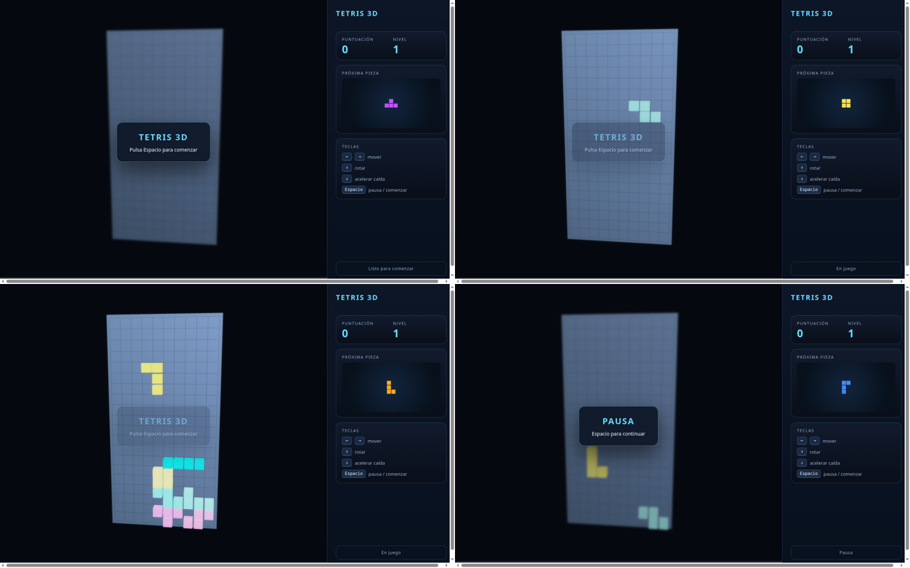
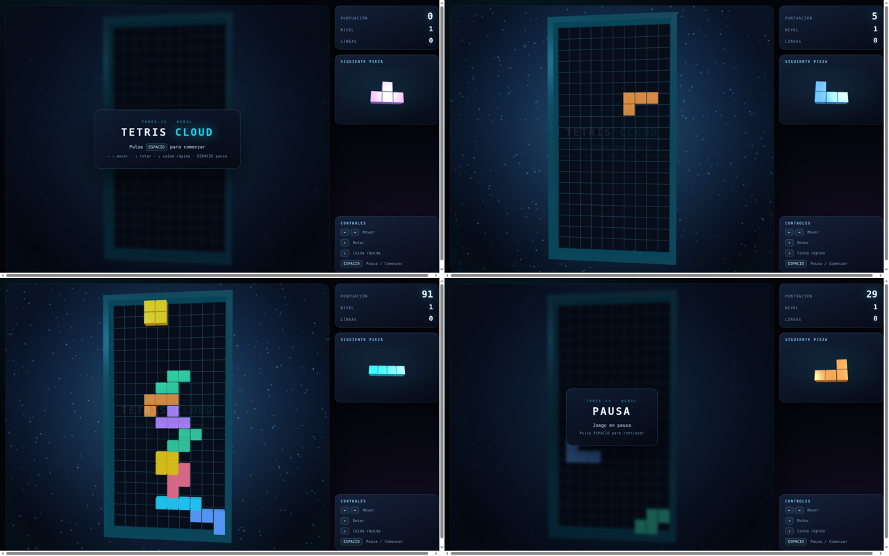
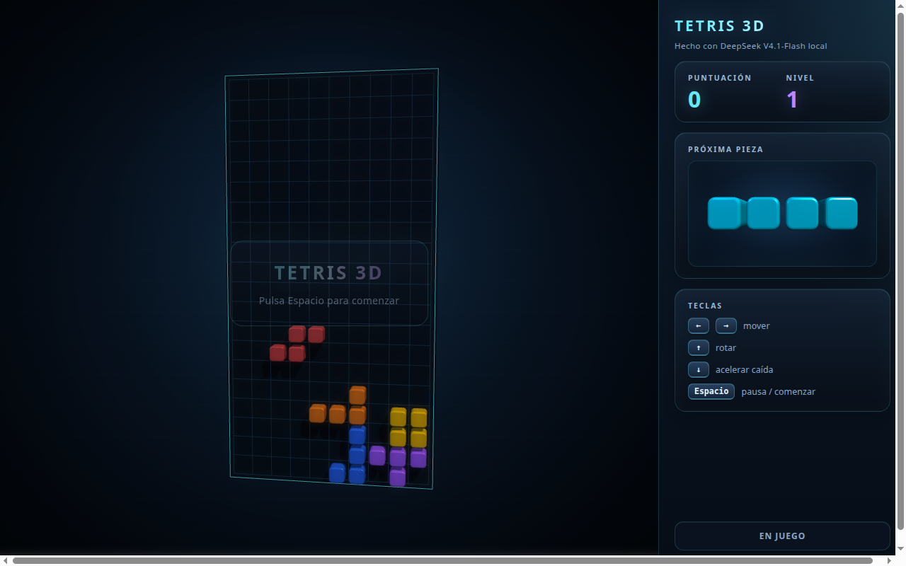

# ds-wormhole: a Tetris, local against the cloud

<sub><b>English</b> · [Español](DS_WORMHOLE_TETRIS.es.md)</sub>

How far is DeepSeek-V4.1-Flash IQ2_XS on a 64 GB Strix Halo from the model DeepSeek serves in its cloud? One simple
test (2026-11-11): the same prompt, the same agent client and the same settings, once against this machine and once
against the official API. Both runs are single samples at temperature 1, so they are an example, not a benchmark.

## Setup

| | Local | Cloud |
|---|---|---|
| Model | DeepSeek-V4.1-Flash-1017 IQ2_XS (2.25 bpw), `strata-dsv41`, P075a profile, 1M context | `deepseek-flash` on `api.deepseek.com` |
| Machine | Ryzen AI MAX+ 395, Radeon 8060S, 64 GB, Linux | DeepSeek's servers |
| Client | the same agent client (vibecode) with the same tools, including a three.js MCP server and a browser | same |
| Sampling | temperature 1, top_p 0.95, top_k 64, min_p 0.066, thinking on, effort high | same request (the official API probably ignores top_k and min_p) |

The prompt (in Spanish, as it was sent; the file name changed between runs):

```text
tenemos un MCP de threejs configurado crea un Tetris en ~/tetris_local.html con:
- panel principal (tablero para las fichas)
- paneles laterales derecha: panel con contador de puntuación y nivel, panel de visualización próxima pieza, teclas de ayuda
- controlado por las teclas de cursor a los lados, arriba rotar, abajo aumentar velocidad de caída. "Espacio" para "PAUSA" y "COMENZAR" partida.
- todas las piezas con colores distintos y rotación (cursor arriba)
- animación parpadeante para eliminar las lineas completadas
```

In short: a three.js Tetris with a board, a right-hand panel (score and level, next piece, key help), arrow keys,
Space to start and pause, a colour per piece, rotation, and a blinking animation when lines are cleared.

## The sessions

| | Local | Cloud |
|---|---|---|
| Wall time | 55 min | 10 min (about 5.5× faster) |
| Tokens written | 63,751 at ~23 tok/s | ~91,000 including thinking, ~150 tok/s |
| Tool calls | 31 | 99 |
| Checked its own work | yes: start, pause, move, rotate, game over in the browser; a four-line clear in an instrumented copy it deleted afterwards | yes, more thoroughly: it looked at screenshots and fixed washed-out colours by itself |
| Typos | one in the final message ("In Incluye") | none |

## The games

Both games load, run and meet every point of the prompt. The screenshots are taken with a headless Chromium (software
WebGL) driving the keys: start screen, playing, later, paused. (The start banner shows half transparent while playing in
both: that comes from the headless capture, not from the games.)

**Local** ([`tetris_local.html`](ds-wormhole-tetris/tetris_local.html)):



**Cloud** ([`tetris_cloud.html`](ds-wormhole-tetris/tetris_cloud.html)):



## Scores (1-10)

| | Local | Cloud | Notes |
|---|---|---|---|
| Meets the prompt | 9 | 9 | both have every requested part |
| Gameplay | 8 | 9 | both use a 7-piece bag and wall kicks; the cloud also counts lines, scores soft drops and levels up every 10 lines |
| Graphics | **5** | **9** | local: a washed-out light-blue board, pastel pieces, an odd perspective. Cloud: frame, grid, glow, particles, bevelled cubes, true colours |
| Side panel | 7 | 9 | local has no line counter and a small flat preview; the cloud's preview is large and spins |
| Code | 7 | 8.5 | the cloud pools its meshes and handles colour space; the local one is correct but plainer |
| Self-checking | 7 | 9 | |
| Text and typos | 8 | 10 | |
| Speed | 2 | 10 | |
| Cost and privacy | 10 | 6 | local is free and nothing leaves the machine |
| **Overall result quality** | **7** | **9** | |

## Second round: the local model improves its own Tetris (v2)

After the comparison, the same local model got one request, this time from the web page `strata-dsv41` serves (the
llama.cpp UI), not from vibecode: *"look at ~/tetris_local.html, the visual quality is not very good, let's see if we can
make it more attractive and sharper"* (in Spanish). Same P075a profile; temperature 1, top_k 64, min_p 0.066.

| | Local v2 (improvement) |
|---|---|
| Duration | ~45 min wall (with a break: the PC went off halfway and the session went on with "continue please") |
| Tokens written | 55,320 in 44 requests, **21.8 t/s**; context up to 75K |
| Tool calls | 49, 0 failed (one read too large, repeated in ranges) |
| How | read the whole game, listed seven problems (colours washed out by the light and no tone mapping, flat cubes, fixed camera, tiny preview, jumpy movement and a CSS bug of v1: `n-child` for `nth-child`), made a plan and applied it in 25 edits |
| Checked its work | **yes, with its own eyes**: took screenshots with headless Chromium, looked at them through vision and recalibrated lights, exposure and saturation three times until they no longer looked washed out; also tried the mobile layout and removed its test files |
| Typos | two in prose, one-offs: "Re reviso" and "Node/PPython"; one in code, `toneMappingExposure = 09`, which it fixed itself in the next edit. The final code has no typos and its JavaScript passes `node --check` |

**Local v2** ([`tetris_local_v2.html`](ds-wormhole-tetris/tetris_local_v2.html)):



Dark board, saturated colours, rounded bevelled blocks with shadows, thin frame and grid, interpolated movement, framing
that follows the window, a glass panel and a large preview. Still no line counter.

| | Local v1 | **Local v2** | Cloud | Notes on v2 |
|---|---|---|---|---|
| Meets the prompt | 9 | 9 | 9 | |
| Gameplay | 8 | 8 | 9 | the logic is unchanged: still no line count |
| Graphics | 5 | **8** | 9 | fixed exactly what the cloud saw on its own (washed-out colours) and added bevels, shadows and framing; the cloud still has the background, particles and a solid frame |
| Side panel | 7 | **8** | 9 | large, embossed preview; no lines |
| Code | 7 | **8** | 8.5 | tone mapping, sRGB, bevelled geometry, interpolation, FOV framing; still one material per block |
| Self-checking | 7 | **9** | 9 | screenshot → look → fix loop, like the cloud |
| Text and typos | 8 | 7 | 10 | two one-offs in prose and one in code it fixed itself |
| Speed | 2 | 2 | 10 | 21.8 t/s |
| Cost and privacy | 10 | 10 | 6 | |
| **Overall quality of the result** | **7** | **8** | **9** | |

**What it adds:** the graphics gap of the first try was attention, not ability. Given a second request, the local model
found on its own the same fault the cloud had fixed by itself (three.js r128's linear colours), fixed it by looking at its
own screenshots and brought the game close to the cloud's. What the cloud does in one pass, the local model does in two.
Typos still show up in the prose: "Re reviso" is the same class as "In Incluye" (a piece of a word followed by the whole
word), and it is being fixed in the engine (`DS4_TIE_SPACE`).

## What it says

- In logic and code the local model is close: a complete game, no visible bugs, every requirement met.
- The gap is the visual finish, and it has a concrete cause. three.js r128 treats a `0xRRGGBB` colour as linear unless it
  is converted, so colours come out washed out. The cloud model saw it in its own screenshots and fixed it
  (`convertSRGBToLinear`, `sRGBEncoding`); the local one did not notice it, or did not treat it as a problem.
- That looks more like attention to detail than missing ability. It may come from the 2.25 bpw quantization, from the
  miss penalty, or from chance: one sample each. Repeating the test, or running it once on the exact route (no
  substitution, ~6 tok/s), would separate those.
- The local run cost nothing and kept everything on the machine; the cloud was about five times faster.
